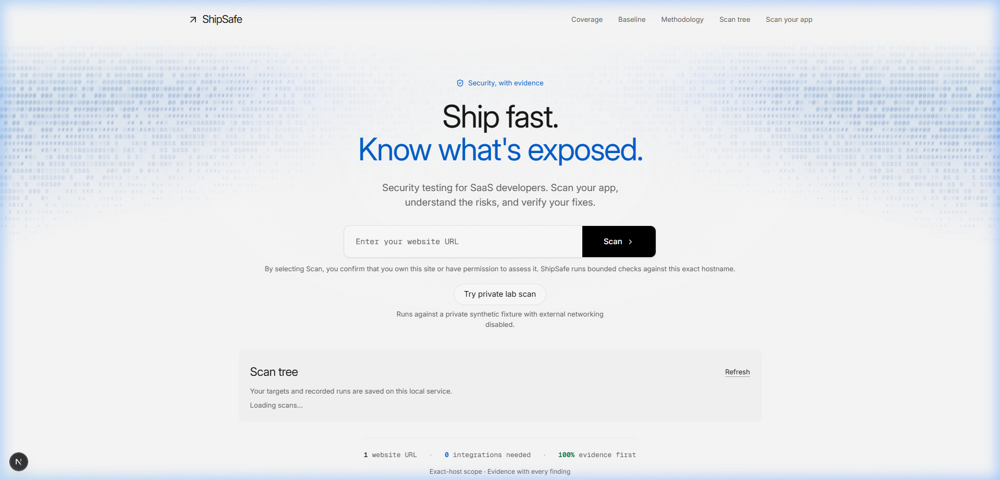
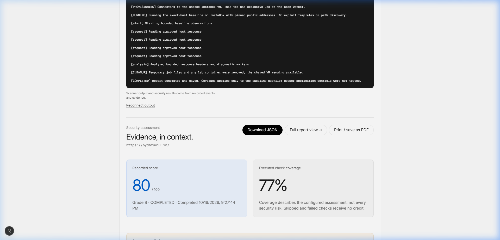

# ShipSafe

An evidence-first, open-source web application security testing engine. It runs non-destructive baseline checks and deep authorized security scans inside ephemeral micro-VM sandboxes with real-time SSE telemetry and zero AI hallucinations.

[](https://www.typescriptlang.org/)
[](https://nextjs.org/)
[](https://bun.sh/)
[](https://vitest.dev/)
[-blue.svg?style=flat-square&logo=python)](https://python.org/)
[](https://instabox.sh/)
[](LICENSE)



A local-first and cloud-ready security scanner for modern web applications. Enter a public URL to run 40+ deterministic baseline checks across TLS/SSL configurations, HTTP security headers, cookie flags, DNS CAA/SPF/DMARC records, mixed content, and public metadata leakage. Completed scans stream live telemetry events to an interactive terminal, calculate an un-inflated evidence score, and offer an expandable deep scan workflow with cryptographic DNS ownership verification and isolated containerized engines (Nuclei & OWASP ZAP).



> **Evidence-first note.** A confirmed finding MUST be backed by raw scanner output or recorded network response data. ShipSafe never uses LLMs to speculate or invent vulnerabilities. Skipped or untested checks are explicitly marked and earn zero score credit. Scans execute exclusively in disposable, kernel-isolated compute (InstaBox micro-VMs) and are immediately torn down upon completion.

## Core Invariants

ShipSafe enforces five strict architectural invariants (RFC 2119):

1. **Evidence First**: Every reported finding contains reproducible raw data (headers, cert chains, DNS records, or response bodies).
2. **No Credit for What Did Not Run**: The security score is calculated strictly as $\frac{\text{Passed Eligible Checks}}{\text{Applicable Eligible Checks}} \times 100$. Untested or deferred checks never improve scores.
3. **Authorization Before Action**: High-intensity tests (repository probing, CORS origin reflection, Nuclei template execution) require verified domain control via a cryptographic DNS TXT challenge (`_shipsafe.HOST`) and explicit, expiring user consent.
4. **Pull Architecture (S-09)**: Sandboxed VMs never hold control-plane secrets, API keys, or long-lived credentials, and never dial back to the ShipSafe control plane. The backend orchestrates execution via the official `@insforge/instabox-sdk`.
5. **Disposable Compute (S-19)**: Every scan sandbox is bounded by strict Linux `prlimit` resource limits (256 MiB memory, 45s CPU, 32 processes) and is guaranteed to be terminated (`Sandbox.kill`) upon completion, failure, or cancellation.

## Scanning Modes

### 1. Standard Scan (Immediate Baseline)
Non-destructive, non-intrusive assessment that requires zero authorization setup:
* **TLS & Transport**: Cipher suites, protocol version (TLS 1.2/1.3), certificate expiration, validity periods, and SAN matching.
* **HTTP Security Headers**: Strict-Transport-Security (HSTS with preload/subdomain checks), Content-Security-Policy (CSP), X-Frame-Options, X-Content-Type-Options, Referrer-Policy, Cross-Origin policies (COOP, COEP, CORP), and Permissions-Policy.
* **Cookie Hygiene**: `Secure`, `HttpOnly`, `SameSite` flags, cookie path boundaries, max age, and `__Host-` / `__Secure-` prefix compliance.
* **DNS Intelligence**: Public IP anti-SSRF validation, DNS CAA records, SPF records, DMARC alignment, and MX presence.
* **Asset Exposure**: Insecure HTTP references inside HTTPS, public source map detection (`sourceMappingURL`), library version leakage, and RFC 9116 `security.txt` discovery.

### 2. Authorized Deep Scan (Verified Scope)
Unlocked only after completing a DNS TXT ownership challenge and granting scoped consent:
* **Exposed Repositories**: Validates `/.git/HEAD` signatures without downloading repository history.
* **Bounded Route Discovery**: Safely extracts up to 3 same-host links, automatically excluding query parameters and destructive keywords (`logout`, `delete`, `reset`).
* **CORS Origin Reflection**: Validates uncredentialed alternate origin handling.
* **Containerized Nuclei**: Runs safe, pre-pulled misconfiguration and exposure templates (`misconfiguration`, `exposure`, `ssl`), strictly excluding fuzzing, injection, and denial-of-service profiles.
* **OWASP ZAP Baseline**: Passive response inspection (`zap-baseline.py`) for session management and anti-CSRF patterns.

## Build and run

### Prerequisites
* [Bun](https://bun.sh) (v1.2+) or Node.js (v20+)
* [Python 3.12+](https://python.org)
* (Optional) [Docker](https://docker.com) or [InstaBox API Key](https://instabox.sh) for sandbox execution

```sh
# Clone repository
git clone https://github.com/dhruvil-codes/shipsafe.git
cd shipsafe

# Install workspace dependencies
bun install

# Start development server
bun run dev
```

Visit [http://localhost:3000](http://localhost:3000) to view the application.

### Environment Configuration

Create a `.env` file in the root or in `apps/web/`:

```sh
# InstaBox Micro-VM credentials (required for remote sandboxing)
INSTABOX_API_KEY=your_instabox_api_key

# Optional: Port configuration (defaults to 3000)
PORT=3000
```

*Note: If no InstaBox API key is set, ShipSafe automatically falls back to safe local execution mode for development.*

## AI Agents & MCP

ShipSafe includes an integrated verification suite and machine-readable data contracts conforming to [Model Context Protocol (MCP)](https://modelcontextprotocol.io) principles:

* **Real-time SSE Event Stream**: Streams JSON events (`check_start`, `check_complete`, `summary`) with millisecond timestamps and check IDs to `GET /api/scans/:id/stream`.
* **Standardized JSON Reports**: Export machine-readable evidence summaries at `GET /api/scans/:id/report`.
* **Deterministic Remediation**: Each check finding includes context-aware code remediation prompts tailored for Next.js, Express, Nginx, Caddy, and Apache.

## Tests

```sh
# Run all workspace unit and integration tests (Vitest)
bun run test

# Run sandbox Python security engine tests
python -m unittest discover -s packages/sandbox/src -p "*_test.py"

# Typecheck all packages
bun run typecheck

# Production build check
bun run build
```

* **Vitest Workspace Suite**: 152 tests across 18 test files covering API routes, security policies, verification tokens, scan flow orchestration, and report normalization.
* **Python Engine Suite**: 49 tests verifying certificate inspection, header auditing, SSRF mitigations, DNS token generation, and sandbox cleanup.
* **Production Build**: Full Next.js 15 static site generation and server action verification.

## License

MIT © [ShipSafe Contributors](LICENSE)
