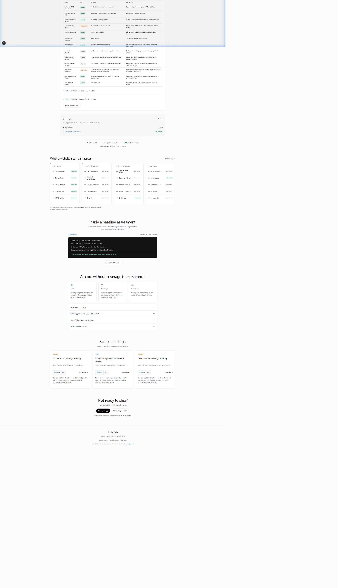
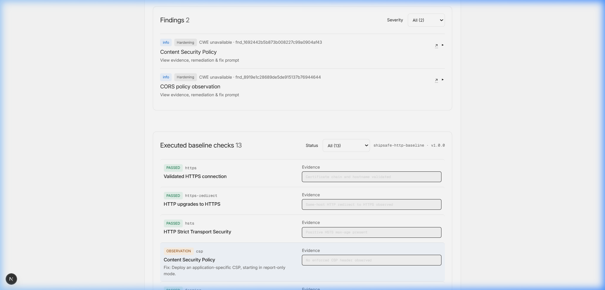
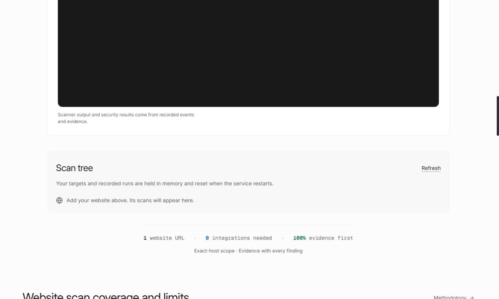

# ShipSafe 🛡️

> **Evidence-First Web Application Security Testing Engine**
> *Zero Hallucinations · Real VM Sandbox Execution · Strict Authorization Controls*

[](https://www.typescriptlang.org/)
[](https://nextjs.org/)
[](https://bun.sh/)
[](https://vitest.dev/)
[-blue.svg?style=flat-square&logo=python)](https://python.org/)
[](https://instabox.sh/)
[](LICENSE)

---

## Overview

**ShipSafe** is an open-source, evidence-first web application security scanner for SaaS developers and security teams. Unlike traditional "AI security scanners" that hallucinate speculative findings, ShipSafe operates on a **strict RFC 2119 evidence-first invariant**:

* **Evidence First**: Every finding is backed by deterministic cryptographic evidence, raw headers, or reproducible scanner outputs.
* **No Credit for What Did Not Run**: Skipped or untested checks are marked `NOT_TESTED` and earn zero score credit.
* **Authorization Before Action**: Active testing is strictly locked behind domain verification (DNS TXT record challenge) and expiring scoped consent.
* **Pull Architecture (S-09)**: Sandboxed VMs never hold control-plane secrets or dial home; the host orchestrates execution via the `@insforge/instabox-sdk`.
* **Kernel-Level Sandboxing**: Linux `prlimit` bounds memory (256 MiB), CPU time (45s), and processes (32) with anti-SSRF IP pinning and advisory serialization locks.

---

## Visual Walkthrough

### 1. Minimal, Distraction-Free Scanner Hero
Enter any website URL to instantly run a bounded, safe Standard Scan against the exact hostname.


---

### 2. Live Terminal Streaming
Watch every elementary check run in real time via Server-Sent Events (SSE) streamed directly from the isolated InstaBox VM.



---

### 3. Transparent Security Posture Score
Scores are calculated as $\frac{\text{Passed Eligible Checks}}{\text{Applicable Eligible Checks}} \times 100$. Inventories and untested checks are excluded so scores are never artificially inflated.


---

### 4. Executed Baseline Checks with Actionable Fixes
Filterable review cards displaying concrete evidence, impact rationales, and exact framework remediation steps.



---

### 5. Authorized Deep Scan & DNS Ownership Gate
Deep active checks require cryptographic proof of domain control via a random DNS TXT token challenge at `_shipsafe.HOST` and expiring, per-action consent.



---

## Scanning Modes

ShipSafe provides two distinct, architecturally separated scanning profiles:

### 1. Standard Scan (URL Only)
*Zero configuration. Immediate execution. Low-impact and completely non-destructive.*

* **TLS & Transport**: Validated HTTPS connection, HTTP-to-HTTPS upgrade verification, certificate expiration & SAN validation.
* **HTTP Security Headers**: Strict-Transport-Security (HSTS), Content-Security-Policy (CSP), X-Frame-Options (clickjacking), X-Content-Type-Options (nosniff), Referrer-Policy, COOP, COEP, CORP, and Permissions-Policy.
* **Cookie Hygiene**: Inspection of `Secure`, `HttpOnly`, `SameSite` (Strict/Lax), domain scope, path boundaries, lifetime, and `__Host-` / `__Secure-` prefixes.
* **DNS Intelligence**: Anti-SSRF public address validation, DNS CAA records, SPF sender authentication, DMARC alignment, and MX records.
* **Public Asset Leakage**: Insecure mixed content references in HTML, third-party script inventory, library version marker detection, and public source map (`sourceMappingURL`) references.
* **Public Metadata**: RFC 9116 `security.txt`, `robots.txt`, `sitemap.xml`, server version disclosure, and diagnostic stack-trace markers.

### 2. Authorized Deep Scan (Verified Scope)
*Unlocked only after verifying domain control (`_shipsafe.HOST` TXT record) and obtaining explicit, expiring per-class consent.*

* **Exposed Repositories**: GET `/.git/HEAD` signature verification (never downloads sensitive source blobs or history).
* **Bounded Discovery**: Extracts up to 3 same-host links without query parameters or state-mutating paths (`logout`, `delete`, `reset`).
* **CORS Origin Reflection**: Uncredentialed alternate Origin (`https://shipsafe-origin.invalid`) validation.
* **Nuclei Integration**: Pre-pulled container runner with 1,500+ vetted, safe templates (`misconfiguration`, `exposure`, `ssl`). Explicitly excludes all destructive/fuzzing/injection tags (`dos`, `fuzz`, `sqli`, `xss`, `rce`, `bruteforce`).
* **OWASP ZAP Baseline**: Passive response analyzer (`zap-baseline.py`) for anti-CSRF token verification and header anti-patterns.

---

## Project Structure

ShipSafe is structured as a modular TypeScript + Python monorepo:

```text
shipsafe/
├── apps/
│   └── web/                   # Next.js 15 App Router frontend & API routes
│       ├── app/               # Landing page, report viewer, scan API routes
│       ├── components/        # Product UI, Terminal, DeepScanAuthorization modal
│       └── lib/               # Assessment normalization, scoring, flow logic
├── packages/
│   ├── sandbox/               # InstaBox VM execution engine & Python scanners
│   │   └── src/               # security_engine.py, baseline.py, security_registry.py
│   ├── orchestration/         # Scan lifecycle orchestration & state machine
│   ├── scoring/               # Posture scoring & explainability algorithms
│   ├── adapters/              # OSINT & tool output normalizers
│   ├── db/                    # Drizzle ORM schemas & database contracts
│   └── shared/                # Shared TypeScript types, enums, & RFC constants
├── doc/                       # Product requirements (PRD), rules, & engine specs
├── assets/                    # Production UI screenshots & diagrams
└── scripts/                   # Local runner, VM check & audit tools
```

---

## Getting Started

### Prerequisites

* **Bun** (v1.2+) or Node.js (v20+)
* **Python** (v3.11+) with standard libraries
* **InstaBox Micro-VM** (or offline fake provider for local testing)

### 1. Installation

```bash
git clone https://github.com/dhruvil-codes/shipsafe.git
cd shipsafe
bun install
```

### 2. Environment Setup

Create `.env.local` in the project root:

```bash
cp .env.example .env.local
```

Configure your credentials:

```ini
# InstaBox Cloud Micro-VM (https://instabox.sh/docs)
INSTABOX_API_KEY=ibk_live_xxxxxxxxxxxxxxxxxxxxxxxx
INSTABOX_SANDBOX_ID=sbx_xxxxxxxxxxxxxxxxxxxxxxxx
SANDBOX_PROVIDER=instabox

# App & Local Runtime
NODE_ENV=development
PORT=3000
SHIPSAFE_PORT=3001
SHIPSAFE_DATA_DIR=.artifacts/local-scans
```

### 3. Verify VM Tool Dependencies

Run our built-in VM verification script to verify all scanner tools (`dig`, `openssl`, `prlimit`, `docker`, `nuclei`, `zap`) on your VM:

```bash
bun scripts/check-vm.mjs
```

### 4. Start the Application

```bash
bun run dev
```

Visit [http://localhost:3000](http://localhost:3000) (or your configured port).

---

## Automated Test Suites

ShipSafe maintains 100% passing test suites across both TypeScript and Python:

```bash
# Run all workspace Vitest suites (152 tests across 18 files)
bun run test

# Run all Python security scanner tests (49 unit tests)
python -m unittest discover -s packages/sandbox/src -p "*_test.py"

# Run TypeScript typechecks across all 7 workspace packages
bun run typecheck

# Build the production Next.js application
bun run build
```

---

## Security Invariants & Policy

| Invariant | Implementation Mechanism |
| :--- | :--- |
| **No Hallucinations** | Deterministic Python parsers only; LLMs never execute commands or invent payloads. |
| **Anti-SSRF** | DNS address resolution rejects RFC 1918, loopback, link-local, and cloud metadata (`169.254.169.254`). |
| **Address Pinning** | Sockets connect directly to the pinned IP while validating TLS against the SNI hostname. |
| **Process Quotas** | Linux `prlimit` limits execution memory to 256 MiB and CPU execution to 45s. |
| **Concurrency Cap** | Advisory `flock` serializes executions to strictly respect InstaBox's 4-exec quota limit. |
| **Clean Teardown** | Process cleanup escalates from `SIGTERM` to `SIGKILL` before purging ephemeral directories. |

---

## License

This project is licensed under the [MIT License](LICENSE).
