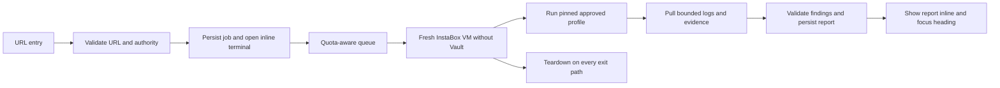

# ShipSafe launch plan and VM preparation

Research and preparation date: 2026-10-16. This is an engineering plan, not a claim that the production scanning service is ready.

Subsequent implementation: the owner chose one persistent VM and deferred deployment. [LOCAL-RUNTIME.md](LOCAL-RUNTIME.md) records the implemented local 13-outcome baseline, single-writer queue, real terminal/report path and cleanup behavior. It supersedes the per-scan VM proposal and disconnected local-runtime status below. The Cloudflare persistence/dispatch adapter and public release validation are still pending.

## Product decision

ShipSafe can provide a single place to assess a website, inspect evidence, understand fixes and retest. It cannot establish that a website has no vulnerabilities or determine every historical breach from a URL. Keep the simple landing interaction, and offer deeper coverage when the owner supplies the required access. GitHub, teams and a settings page are not prerequisites: source archives, lockfiles, SBOMs, schemas and disposable test accounts can be supplied when relevant.

The [77-check catalog](SECURITY-TEST-CATALOG.md) and [CSV](SECURITY-TEST-CATALOG.csv) describe proposed coverage, access, evidence and remediation for each case. All 77 cases are PLANNED. Engine installation and the private smoke test below do not change those product statuses. Fifteen checks are proposed MVP priorities: ten low-impact exact-host observations and five access-dependent essentials. The latter cannot be inferred from a URL.

Ora remains the interaction reference. Its own [website](https://ora.ai/) describes agent-readiness assessment; that is not evidence for a comprehensive security-scanner architecture. The Agentic comparison was dropped at the user's request.

## Coverage and common shipping mistakes

| Area | Checks to implement | Typical remediation | Required input |
| --- | --- | --- | --- |
| Transport and browser controls | Certificate validity/expiry, HTTPS redirects, HSTS, CSP, framing, MIME sniffing, referrer policy, mixed content | Correct certificate/redirect configuration; deploy tested response policies | Authorized hostname; page/asset access for mixed content |
| Authentication and sessions | Reset/account enumeration, token validation/expiry, logout/revocation, cookie attributes, CSRF, admin enforcement, OAuth callback/state handling | Validate on the server; rotate/revoke sessions; constrain redirects and CSRF | Test accounts and staging for behavioral cases; source/config for implementation review |
| Tenant and database isolation | Cross-user reads/writes, Supabase RLS, public/service-role key boundaries, file/export/cache/search/vector isolation, deletion/restore | Enforce identity and tenant at every storage/query boundary; least privilege | Two test identities, seeded data, schemas/policies and artifacts |
| Input and API handling | SQL/command/template injection, reflected/stored/DOM XSS, SSRF, uploads, path traversal, CORS, error disclosure | Parameterize, encode at the sink, allowlist egress/paths/types; enforce server validation | Authorized staging/API schema/source; ordinary headers alone support only a small subset |
| Secrets and dependencies | Server secrets in client bundles/history, vulnerable direct/transitive dependencies, image vulnerabilities, unsafe package/build workflows | Revoke exposed credentials; remove from artifacts/history; upgrade and rebuild | Supplied source/build artifacts, lockfiles, SBOM or image |
| Cloud and deployment | Public storage, broad IAM, exposed admin/debug services, environment separation, container privileges, CI permissions, backup/log access | Reduce effective grants; close ingress; isolate production credentials and deployment roles | Read-only configuration/IaC/provider access; URL cannot prove private IAM state |
| Payments and business rules | Webhook signatures/replay, client-controlled prices, duplicate fulfillment, coupon/credit abuse, ownership changes | Verify signed raw payloads, enforce idempotency, calculate prices/permissions server-side | Provider sandbox and synthetic orders/accounts |
| AI and MCP | Tool authorization, cross-tenant retrieval/memory, secret disclosure, unsafe output sinks, excessive spend/capabilities | Deterministic tool/resource policy, isolated retrieval, safe output handling and budgets | Owned agent fixture, test identities, policy/source access |

The sequencing emphasizes missing server authorization, RLS, leaked service-role keys, webhook verification, SSRF and privileged AI tools alongside the visible header checks. These are engineering priorities, not a prevalence measurement. A Supabase publishable/anon key is not inherently a secret. Missing CSP is a hardening observation unless a specific exploitable boundary failure is established. Prompt injection alone does not prove a consequential security failure.

References: [OWASP ASVS](https://owasp.org/projects/asvs), [WSTG](https://wstg.owasp.org/stable/4-Web_Application_Security_Testing/), [API Security Top 10](https://api-security.owasp.org/editions/2023/en/0x11-t10/), [Supabase RLS](https://supabase.com/docs/guides/database/postgres/row-level-security), [Supabase API keys](https://supabase.com/docs/guides/api/api-keys), [Stripe signatures](https://docs.stripe.com/webhooks/signature). Payment implementation must follow the actual configured provider.

## Cloudflare methodology to adopt

Reviewed [Cloudflare security-audit-skill](https://github.com/cloudflare/security-audit-skill) at commit `c1c8a8c1471069fb0e188eeaff69b8e8db6564a8`, including its attack, deployment, data-lifecycle and AI companion guidance. It is MIT licensed; preserve its notice when incorporating material. This pass used guidance mode, not a full ShipSafe source audit.

Adopt a coverage ledger, explicit trust boundaries, evidence-backed candidate findings, independent verification, and separate `confirmed`, `needs_validation` and `rejected` records. A needs-validation item records the exact missing fact without a confirmed severity. Keep source-confirmed implementation issues distinct from observed deployed behavior. Add prior-run comparison and retesting without carrying stale evidence forward as a current pass.

For supplied code and local fixtures, use OS-enforced isolation, no external networking, an allowlisted environment, scratch-only writes, and resource/time limits. Keep source-audit workers separate from live HTTP workers, whose egress must be restricted to the authorized target. Never let scanned content issue control-plane instructions or choose commands, templates, tools or network scope.

## Required scan journey

1. On submission, show loading immediately. Validate the exact public HTTP(S) host, canonical URL, size limits and rate limits. Reject private/reserved/metadata addresses and unsafe ports. Revalidate DNS and every redirect at the egress enforcement point, not just during URL parsing.
2. Validate owner authority before probes. A one-time DNS/hosted-file challenge or a trusted deployment proof can be a compact first-scan step without restoring a permanent ownership column. Record authority, scope, profile and expiry server-side. For today's demonstration use only a controlled fixture. No third-party target has been authorized in this session.
3. Create a durable job and show its actual queued/provisioning/running state in Magic UI Terminal. Provision a fresh isolated InstaBox scan VM with `vault:false`; do not put customer code in the existing credential-bearing preparation VM. Keep provider credentials only in the backend.
4. Load tools by reviewed immutable digest from a clean image/snapshot. Enforce exact-host egress, concurrency, request limits, body limits, redaction and wall-clock deadlines outside the tool. A tool's own scope flag is not sufficient.
5. The backend drives execution and pulls append-only bounded logs. InstaBox command results arrive on completion: use a background process with offset-based file polling for live progress. Persist ordered events and send resumable SSE with event IDs, replay and disconnect recovery. Do not animate invented scanner output.
6. Parse structured output as untrusted data, validate the schema and evidence, deduplicate conservatively, then persist the report before sending `report_ready`. Display findings inline and focus the report heading. For partial failure, show a partial report with explicit failed/skipped coverage.
7. Always kill the per-scan VM on success, failure, cancellation and timeout. Persist teardown intent and use an orphan reaper for backend crashes; attach expiry metadata and a provider deadline. Retry idempotently without exceeding quota. Standard-account scheduling must account for five total machines and four concurrent execs; the two existing account machines consume part of that allowance.

The product currently stops before these live-execution steps. `/api/scans` remains fail-closed with `EXECUTION_NOT_READY`; the store is in memory and SSE does not yet drive durable live jobs. The legacy shared-VM/subdomain-probing runner must not be enabled as the production path.

## Report contract

Each completed assessment must include scope/profile, authorization reference, timestamps, engine/image/rule/database versions, checks attempted, checks completed, unavailable access, failures, skipped tests and teardown status. Never award coverage or score credit for checks that did not run.

For each finding retain a stable ID, affected endpoint/resource, bounded redacted evidence, validation verdict, confidence, contextual severity where established, practical impact, specific remediation and a safe retest. Link AI explanations and fix prompts to the evidence; an LLM cannot promote a hypothesis to confirmed. Never expose active credentials or another customer's data in a report or terminal.

Show verified positive observations with their conditions, such as a validated certificate or denial of a cross-account read in a particular seeded test. Label hardening notes separately. Say "no issue detected in the completed checks" rather than "secure". A scan is not a certification or proof that no breach occurred. Applying a generated patch is a separate owner-controlled action, followed by tests and retesting.

## What was prepared on shipsafe-vm

The existing VM was used only for trusted tool preparation and an owned private fixture. Its Vault is enabled, so it is not a clean customer-code execution base. No Vault values were printed or passed to containers. Docker containers received no host directories, socket or environment secrets and were network-disabled, read-only except private tmpfs, capability-dropped and bounded by CPU, RAM, PID, file-size and wall-clock limits.

| Engine | Installed image version | Current verification |
| --- | --- | --- |
| ZAP | 2.17.0 | Clean network-disabled version initialization; private fixture result recorded separately |
| Nuclei | 3.11.1 | Clean network-disabled version check; reviewed template allowlist is not staged |
| Trivy | 0.76.0 | Clean network-disabled version check; vulnerability DB/feed readiness is not validated |
| Gitleaks | 8.30.1 | Clean network-disabled version check; customer-source adapter is not implemented |

All four images were resolved to immutable SHA-256 digests in `.artifacts/security-catalog/tool-readiness.json`. Initial checks exposed insufficient writable scratch for ZAP and a read-only config path for Nuclei; the corrected checks use adequate private scratch and a resolvable local hostname. Exit code zero alone was not treated as clean initialization. Earlier raw preparation results are historical, superseded by the clean readiness record.

The private ZAP baseline smoke test produced a JSON report for an intentionally unhardened synthetic page on container loopback. It reported four alert families: missing CSP (10038), missing anti-clickjacking controls (10020), server-version disclosure (10036) and missing MIME-sniffing protection (10021). These are fixture hardening observations, not evidence of exploitable customer vulnerabilities. The container was verified removed. The wrapper's generic PASS counts are not proof of authentication, tenant, payment or other absent application controls. It also fetched its default robots/sitemap paths; production scope must explicitly allow crawler behavior before using this wrapper.

Retest: added CSP, framing and MIME-sniffing controls and suppressed the fixture server banner. The first retest identified missing CSP `form-action` (10055), which does not inherit from `default-src`; that output was preserved. After adding `form-action 'none'`, the final baseline generated its JSON report with zero alerts and the container was verified removed. This establishes the fixture's detect/fix/retest behavior for that profile only. It does not establish security of a real application. Evidence: `.artifacts/security-catalog/fixture-result.json`, `fixture-first-retest-result.json` and `fixture-hardened-result.json`; the final two include raw ZAP reports. No customer targets or external websites were scanned.

Licensing inventory and links are in [the research](SCAN-IMPLEMENTATION-RESEARCH.md). Review image dependencies, add-ons, templates, data-feed terms and notices as well as engine licenses. Do not bundle Semgrep-maintained rules in a competing SaaS without an agreement. Nmap remains excluded pending its special licensing review. Tool licenses do not authorize testing a target, and provider permission for the scanner service remains unverified.

## Always-on behavior and cron

Official [InstaBox documentation](https://instabox.sh/docs) describes disabling idle suspension with zero and clearing the timeout with zero. On this account, SDK, direct API and CLI calls accepted the idle-disable operation, but fresh reads still returned `autoSuspendAfterSeconds:1800`. No timeout/archive deadline was returned. Therefore **always-on operation has not been achieved**. Provider feedback was accepted with ID `c24f9ef4-c3ad-45d0-8aa8-1a87acf92cbf`.

A 25-minute external authenticated exec may count as activity or wake a suspended box, but that is not proof of uninterrupted uptime. An HTTP ping may not count as qualifying activity. A cron process inside a suspended VM cannot wake itself. A development laptop scheduler also stops when the laptop sleeps. Do not rely on a busy loop or claim a keepalive guarantee without testing the provider's behavior and acceptable-use terms.

Preferred production design: keep the control plane and durable queue outside disposable workers; provision/resume on demand, probe health before dispatch, retry transient failures, expose a truthful provisioning state, and enforce cleanup. This avoids requiring a scan worker to run 24/7. If the demo preparation VM needs to stay warm, obtain a working native lifecycle setting from InstaBox; a separately hosted authenticated monitor is only a fallback, with alerts and verified recovery. No cron or Codex automation was created.

## Same-day submission boundary

The defensible submission today is the URL-first interface plus a clearly labeled private-lab demonstration of real execution, logs and evidence on InstaBox. Do not unlock arbitrary public scanning to meet the deadline. The public endpoint is ready only after durable jobs/reports, verified authority, enforced scope/egress, credential-free per-job VMs, quota controls, replayable events, parser validation, cancellation, teardown/reaping and controlled end-to-end checks are working.

Required release checks include approved and unapproved hosts; private IPs and DNS rebinding; off-scope redirects; queue saturation/429; scanner crash and timeout; cancellation during provisioning/running/report generation; backend restart and SSE replay; evidence redaction/HTML injection; cross-user report access; unavailable template/DB; partial reports; idempotent completion; and verified VM cleanup on every failure path. A single fixture smoke test cannot replace them.
